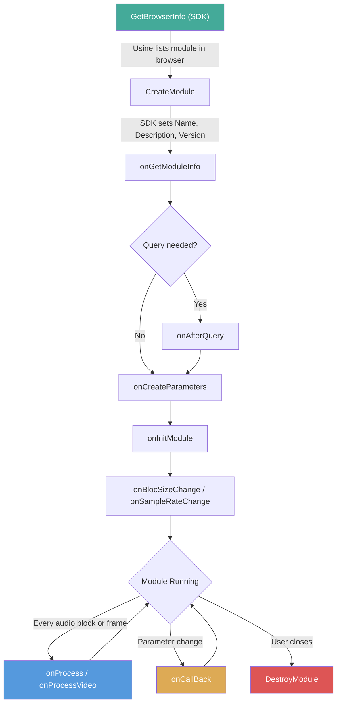
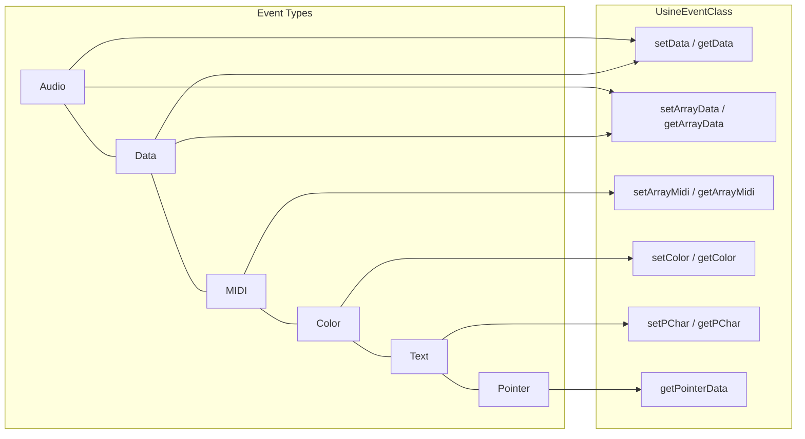
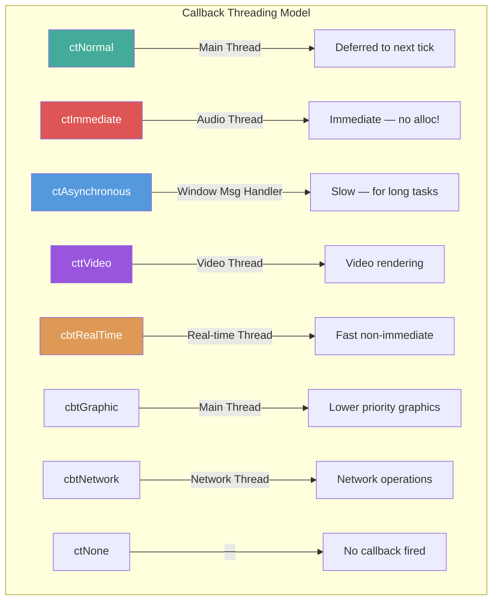
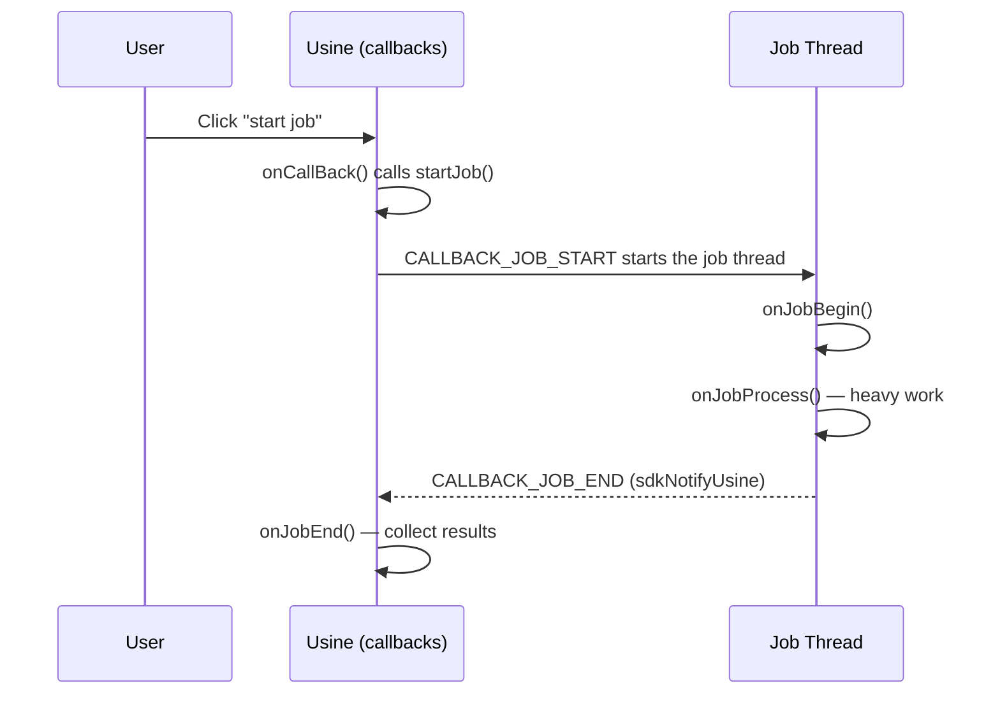
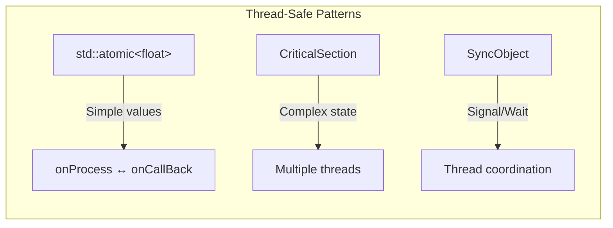

# Module Architecture

#sdk #architecture #lifecycle #callbacks #events #audio #threading

## Overview

A Usine user module is a C++ dynamic library (DLL/dylib) that Usine loads at runtime. Each module inherits from [[sdk/user-module-base|UserModuleBase]] and communicates with Usine through a well-defined callback system.

## Module Types

| Type | Constant | Description | Examples |
|------|----------|-------------|----------|
| Simple | `mtSimple` | Data, audio, or MIDI processing (no canvas) | [[examples/audio-volume|AudioVolume]], [[examples/reverb|Reverb]] |
| Control | `mtControl` | Module with a visual canvas for custom drawing | [[examples/draw-box|DrawBox]], [[examples/granulator|Granulator]] |
| Video | `mtVideo` | Video frame processing module | [[examples/video-dimmer|VideoDimmer]] |
| Device Audio | `mtDeviceAudio` | Audio device driver | — |
| Device MIDI | `mtDeviceMidi` | MIDI device driver | — |
| Device DMX | `mtDeviceDMX` | DMX lighting device | — |
| Device Laser | `mtDeviceLaser` | ILDA laser device | — |
| Device Other | `mtDeviceOther` | Other device types | — |
| Plugin Wrapper | `mtPluginWrapper` | VST/AU plugin wrapper | — |
| Plugin Lister | `mtPluginLister` | Plugin lister | — |
| Background Job | `mtBackgroundJob` | Module with a background job, the SDK adds its `processing` outputs | [[examples/background-job|BackgroundJob]] |
| Other | `mtOther` | Other module types | — |

See [[sdk/data-types|Data Types]] for the full `TModuleType` enum.

## Module Lifecycle



## Global Functions

Usine calls three global functions of the module library. The module implements two of them, the SDK the third one.

### CreateModule
```cpp
void CreateModule(void*& pModule, AnsiCharPtr optionalString,
                  LongBool Flag, TMasterInfo* pMasterInfo,
                  AnsiCharPtr optionalContent);
```
Called by Usine to instantiate your module. Allocate your module class with `new` and assign to `pModule`.

### DestroyModule
```cpp
void DestroyModule(void* pModule);
```
Called by Usine to destroy the module. Cast back to your class and `delete` it.

### GetBrowserInfo (implemented by the SDK)
```cpp
void GetBrowserInfo(TModuleInfo* pModuleInfo);
```
Called by Usine to populate the module browser. `UserModule.cpp` implements it: it sets `Name`, `Description` and `Version` from the `MODULE_*` constants defined in `ModuleDefinition.h`. The SDK also calls it before `onGetModuleInfo`, so these three fields are already set there.

> **Warning:** don't implement `GetBrowserInfo` in the module: it would be defined twice and the link would fail.

See [[getting-started|Getting Started]] for a complete minimal implementation, and [[sdk/module-conventions|Module Conventions]] for the files of a module.

## Data Flow: The Event System

All data in Usine flows through **events** ([[sdk/usine-event-class|UsineEventClass]]). An event is essentially a typed array of `float` values that can represent:



- **Audio data** — samples in a block (size = block size)
- **Data values** — single floats or arrays
- **MIDI codes** — packed [[sdk/data-types|TUsineMidiCode]] messages
- **Colors** — ARGB color values ([[sdk/data-types|TUsineColor]])
- **Text** — string data
- **Pointers** — raw typed pointer data (see [[examples/usine-pointers|UsinePointers]])

### Event Binding

Each parameter is described by a `constexpr TParamInfo` in `ModuleDefinition.h`, and created in `onCreateParameters()` with `sdkCreateParam()`, which also binds it to its event:

```cpp
// ModuleDefinition.h
inline constexpr TParamInfo inputFdrInParamInfo {
	.ParamType    = ptDataField,
	.Caption      = "input",
	.IsInput      = TRUE,
	.IsOutput     = FALSE,
	.CallBackType = ctNormal,
	.CallBackId   = INPUT_FDR_CBID
};

// MyModule.cpp
void MyModule::onCreateParameters(TMasterInfo* pMasterInfo, TModuleInfo* pModuleInfo)
{
	sdkCreateParam(inputFdrInParamInfo, inputFdrIn);
	sdkCreateParam(outputFdrOutParamInfo, outputFdrOut);
}
```

Once bound, Usine automatically populates input events and reads output events. Parameters appear in the order they are created.

> **Note:** `onGetParamInfo()` with `setEventClass()` and `NumberOfParams` is the legacy way to declare parameters. New modules don't set `NumberOfParams` (it stays at 0) and use `onCreateParameters()`.

## Callback System

### Message Structure

Callbacks receive a [[sdk/data-types|TUsineMessage]] with:
- `message` — `NOTIFY_MSG_USINE_CALLBACK` for the messages sent to the module
- `wParam` — the `CallBackId` of the parameter (or of the command, chunk subscription...)
- `lParam` — message type (`MSG_CHANGE`, `MSG_CLICK`, `MSG_DBLCLICK`, `MSG_CHUNK_DESTROYED`, etc.)

Every example filters the message the same way before dispatching on `wParam`:

```cpp
void MyModule::onCallBack(TUsineMessage* Message)
{
	if ((Message->message != NOTIFY_MSG_USINE_CALLBACK) || (Message->lParam != MSG_CHANGE))
		return;

	switch (Message->wParam)
	{
		case INPUT_FDR_CBID:
			outputFdrOut.setData(inputFdrIn.getData() * 2.0f);
			break;
		default:
			break;
	}
}
```

### Callback Types



| Type | Constant | Thread | When |
|------|----------|--------|------|
| Normal | `ctNormal` | Main thread | Deferred to next tick |
| Immediate | `ctImmediate` | Audio thread | Immediately on change |
| Asynchronous | `ctAsynchronous` | Window message handler | For long processes or modal windows |
| Video | `cttVideo` | Video thread | Video rendering thread |
| Real-time | `cbtRealTime` | Real-time thread | Fast but not immediate |
| Graphic | `cbtGraphic` | Main thread (slower) | Lower priority graphic updates |
| Network | `cbtNetwork` | Network thread | Dedicated network operations |
| None | `ctNone` | — | No callback fired |

> **Warning:** `ctImmediate` callbacks run on the audio thread. Never allocate memory or perform blocking operations in immediate callbacks.

## Audio Processing

The `onProcess()` callback is called on the audio thread at each block:

```cpp
void onProcess() override
{
    // Process audio - called every block (e.g., 256 samples)
    outputAudio.copyfrom(inputAudio);
    outputAudio.mult(gainCoefficient);
}
```

**Rules for `onProcess()`:**
- No memory allocation (`new`, `malloc`, `std::vector::push_back`)
- No blocking operations (locks, file I/O, network)
- No Usine SDK calls that aren't marked as real-time safe
- Keep processing as fast as possible

Set `DontProcess = TRUE` in `onGetModuleInfo()` if your module doesn't need audio processing.

**Examples:** [[examples/audio-volume|AudioVolume]], [[examples/reverb|Reverb]], [[examples/ring-mod|RingMod]], [[examples/granulator|Granulator]]

## Multi-Channel Audio

Modules can support variable channel counts using the **audio query system** (see [[sdk/sdk-functions|sdkGetAudioQueryTitle]]):

```cpp
void AudioVolume::onGetModuleInfo(TMasterInfo* pMasterInfo, TModuleInfo* pModuleInfo)
{
	pModuleInfo->QueryListString     = sdkGetAudioQueryTitle();
	pModuleInfo->QueryListValues     = sdkGetAudioQueryChannelList();
	pModuleInfo->QueryListDefaultIdx = 1;
}

// called after the query popup, before onCreateParameters
void AudioVolume::onAfterQuery(TMasterInfo* pMasterInfo, TModuleInfo* pModuleInfo, int queryResult1, int queryResult2)
{
	queryResult       = queryResult1;
	numOfAudioInsOuts = std::min(sdkGetAudioQueryToNbChannels(queryResult1), static_cast<int>(USINE_AUDIO_CHANNEL_MODULE_MAX));
}

void AudioVolume::onCreateParameters(TMasterInfo* pMasterInfo, TModuleInfo* pModuleInfo)
{
	for (int num = 0; num < numOfAudioInsOuts; num++)
	{
		TParamInfo audioIn = audioInParamInfo;
		audioIn.Caption    = sdkGetAudioQueryChannelNames("in ", num + 1, queryResult);
		sdkCreateParam(audioIn, audioInputs[num]);
	}
	// ... same for the outputs, then the controls
}
```

Clamp the channel count to `USINE_AUDIO_CHANNEL_MODULE_MAX`: the event arrays of the module have this size.

**Examples:** [[examples/audio-volume|AudioVolume]], [[examples/ring-mod|RingMod]], [[examples/reverb|Reverb]], [[examples/granulator|Granulator]]

## Background Jobs

For long-running tasks that can't run in `onProcess()`:



```cpp
void BackgroundJob::onCallBack(TUsineMessage* Message)
{
	// ...
	if (Message->wParam == START_BTN_CBID)
		startJob();
}

void BackgroundJob::onJobBegin()   { /* setup */ }
void BackgroundJob::onJobProcess() { /* heavy computation here */ }
void BackgroundJob::onJobEnd()     { /* collect results, update outputs */ }
```

`startJob()` doesn't run anything itself: it notifies Usine, and the SDK starts the job thread when the notification comes back. `onJobBegin` and `onJobProcess` run on the job thread. When they return, the SDK notifies Usine again and calls `onJobEnd` from the callback dispatch, in real-time mode (`numRealTime`). If a job is still running, the new start is postponed until it ends.

With `ModuleType = mtBackgroundJob`, the SDK also creates two outputs after the parameters of the module: `processing`, on while the job runs, and `processing time`, the duration of the last job (see [[sdk/user-module-base|UserModuleBase]]).

**Example:** [[examples/background-job|BackgroundJob]]

## Chunk System (Persistence)

For saving/loading custom module state beyond parameter values:

```cpp
int MyModule::onGetStateChunkLen(LongBool Preset)
{
	return static_cast<int>(sizeof(myData));
}

void MyModule::onGetStateChunk(void* chunk, LongBool Preset)
{
	std::memcpy(chunk, &myData, sizeof(myData));
}

void MyModule::onSetStateChunk(const void* chunk, int sizeInBytes, LongBool Preset)
{
	// the chunk comes from a file: check its size before reading it
	if (sizeInBytes < static_cast<int>(sizeof(myData)))
	{
		sdkRaiseError(ERROR_INVALID_CHUNK);
		return;
	}
	std::memcpy(&myData, chunk, sizeof(myData));
}
```

> **Note:** these callbacks save the state of the module itself. The **Usine chunks** of [[examples/usine-chunks|UsineChunks]] are a different system: named data shared between modules.

**Examples:** [[examples/draw-trajectory-box|DrawTrajectoryBox]], [[examples/simple-pad|SimplePad]], [[examples/usine-chunks|UsineChunks]]

## Settings Panel

Add persistent settings via the Settings Panel (see [[sdk/data-types|Settings Tab Constants]]):

```cpp
void onCreateSettings() override
{
    sdkAddSettingLineColor(DESIGN_TAB_NAME, &myColor, "Color", TRUE);
    sdkAddSettingLineBoolean(DESIGN_TAB_NAME, &showGrid, "Show Grid", TRUE);
    sdkAddSettingLineInteger(DESIGN_TAB_NAME, &gridSize, "Grid Size",
                            1, 100, scLinear, "", 10, TRUE);
}

void onSettingsHasChanged() override
{
    sdkRepaintPanel();
}
```

**Examples:** [[examples/data-oscilloscope|DataOscilloscope]], [[examples/draw-box|DrawBox]], [[examples/simple-pad|SimplePad]]

## Custom Drawing (mtControl)

Modules of type `mtControl` can draw on a canvas using the [[sdk/user-module-base|drawing utility methods]]:

```cpp
void onPaint() override
{
    TRectF rect = {0.1f, 0.1f, 0.9f, 0.9f};
    sdkFillRect(rect, myColor, 2.0f, clBlack, 0.0f);
    sdkFillText(rect, "Hello", clWhite, 14.0f, FALSE, FALSE, taCenter, taCenter);
}

void onMouseDown(TMouseButton Button, TShiftState Shift, float X, float Y) override
{
    // Handle mouse click at normalized coordinates (0-1)
}
```

**Examples:** [[examples/draw-box|DrawBox]], [[examples/draw-trajectory-box|DrawTrajectoryBox]], [[examples/data-oscilloscope|DataOscilloscope]], [[examples/simple-pad|SimplePad]]

## Thread Safety



- A value written in `onCallBack()` and read in `onProcess()` crosses threads, unless the callback is `ctImmediate` (audio thread). Copy it into a local at the start of `onProcess()` so the whole bloc uses the same value (see [[examples/ring-mod|RingMod]]), and use `std::atomic<>` or a critical section for anything bigger than a single value
- Use `sdkCriticalSectionCreate/Lock/UnLock` for complex shared state — see [[examples/multithreading|MultiThreading]]
- Use `sdkSyncObjectCreate/Set/Wait` for thread synchronization — see [[examples/ring-mod-multithread|RingModMultithread]]
- Never lock in `onProcess()` if it can be avoided

## Errors and Messages

Modules report errors, warnings and infos with `sdkRaiseError`, never with the raw `sdkTrace*` functions. Each message is registered once with `RegisterError` in `ModuleDefinition.h`, the user can filter them with a verbosity level:

```cpp
// ModuleDefinition.h
inline const int WARNING_MAX_POINTS = RegisterError(Level::Warn, "maximum number of points reached");

// MyModule.cpp
if (trajectory.num == MAXPOINTS)
	sdkRaiseError(WARNING_MAX_POINTS);
```

See [[examples/error-handling|ErrorHandling]] and [[sdk/module-conventions|Module Conventions]].

## Related Pages

- [[sdk/module-conventions|Module Conventions]] — Files, naming and style of a module

- [[sdk/user-module-base|UserModuleBase Class]] — Complete callback reference
- [[sdk/usine-event-class|UsineEventClass]] — Event manipulation API
- [[sdk/data-types|Data Types & Constants]] — All SDK types
- [[sdk/sdk-functions|SDK Functions]] — Utility function reference
- [[sdk/utility-functions|Utility Functions]] — Color, geometry, math helpers
- [[getting-started|Getting Started]] — Your first module
- [[docs/writing-user-modules-windows|Windows Setup]] — Visual Studio configuration
- [[docs/writing-user-modules-macos|macOS Setup]] — Xcode configuration
